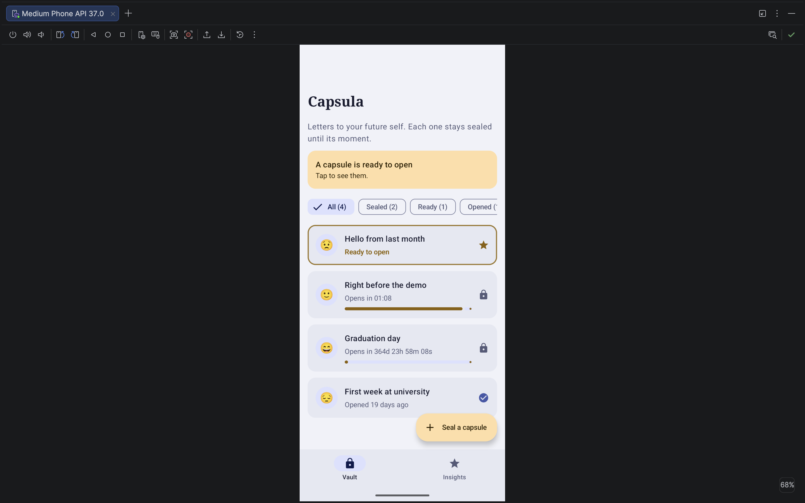
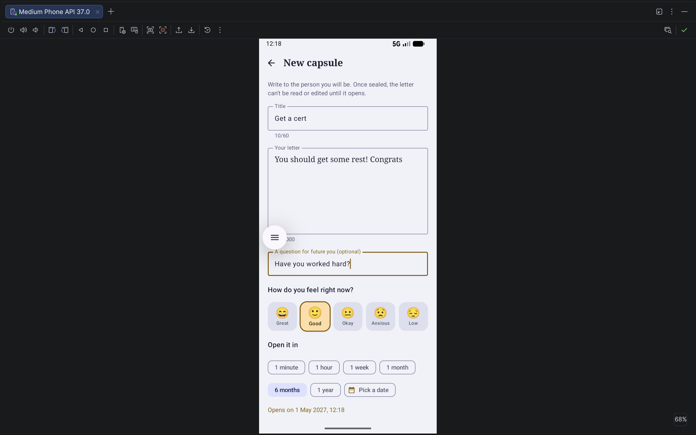
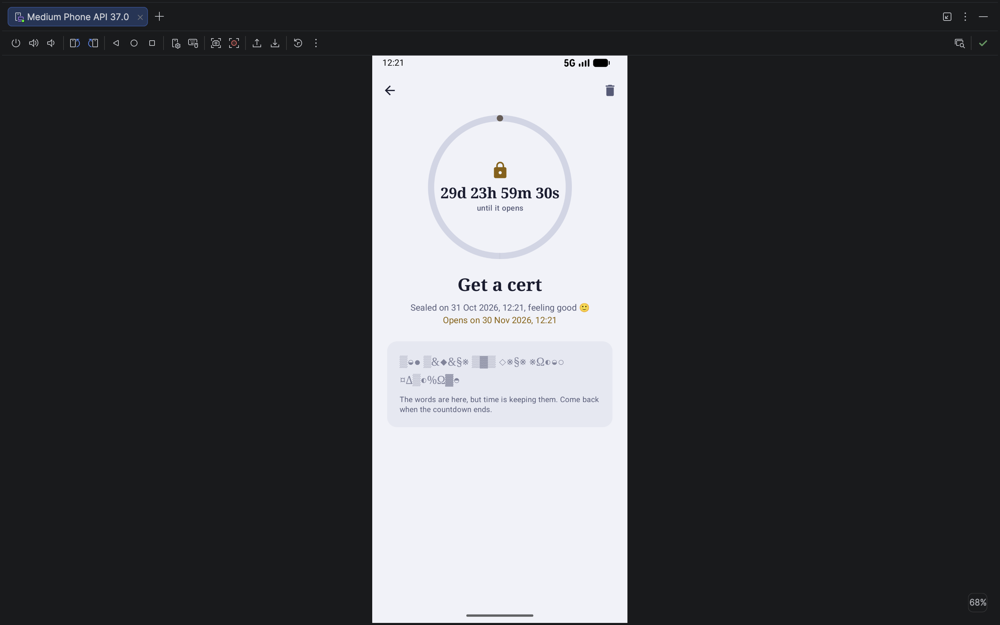
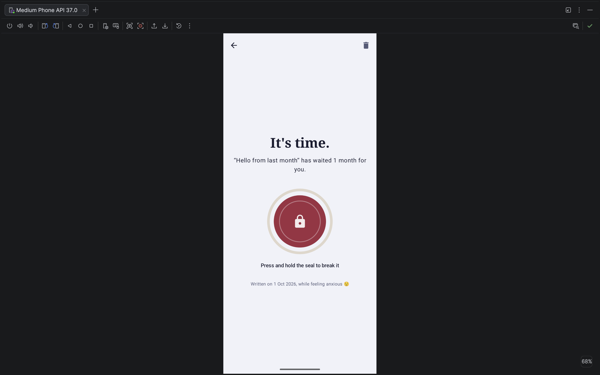
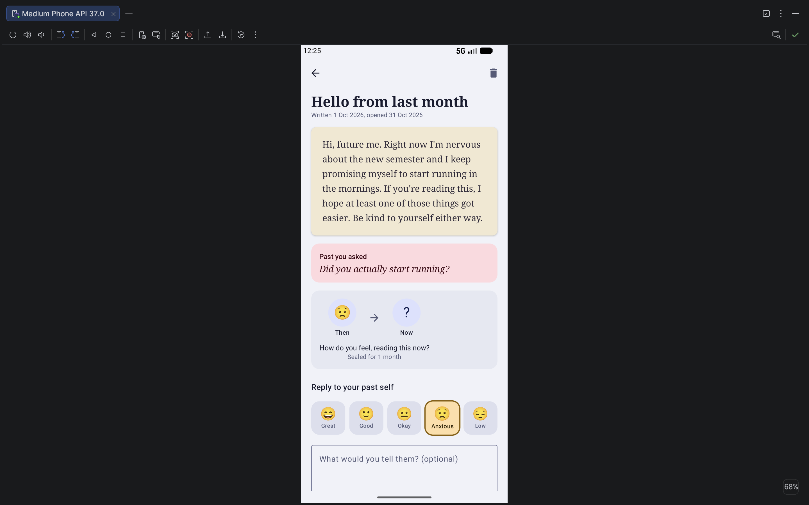
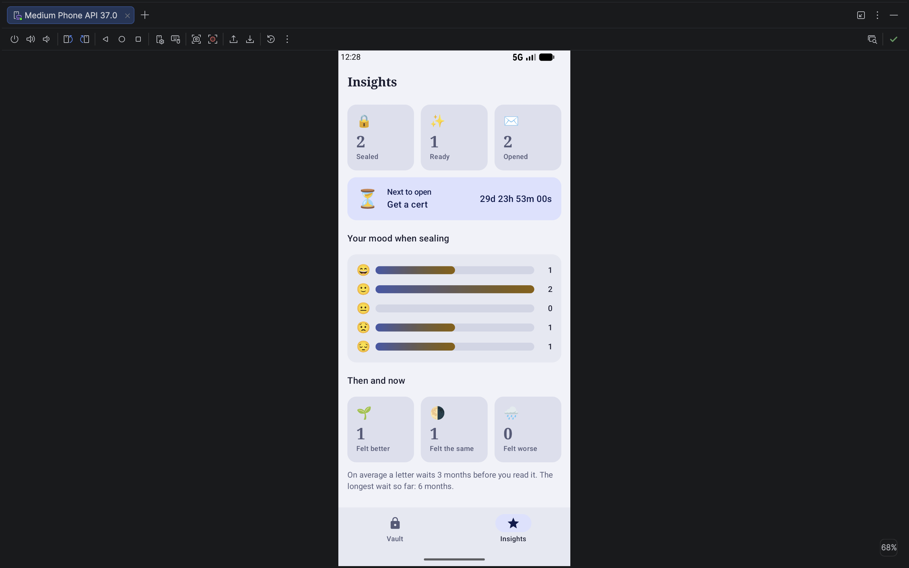

# Capsula — letters to your future self

Capsula is a time-capsule app. You write a letter to the person you will be, choose when it may be
opened, and seal it. Until that moment the letter can't be read or edited: the app only shows a live
countdown and the "seal" (the shape of your words, hidden behind shimmering glyphs). When the time
comes, you break a wax seal by pressing and holding it, the letter decodes itself on screen, and you
reply to your past self. Over time the app shows how your feelings changed between writing and reading.

**Why it is useful:** writing to your future self is a known reflection technique. It helps set
intentions ("did you start running?"), makes progress visible ("I was anxious, now I'm fine"), and
turns ordinary days into small events to look forward to.

Built with **Kotlin, Jetpack Compose, Material 3, Navigation Compose, ViewModel + StateFlow, coroutines**.

## Screenshots

| Vault | New capsule | Sealed capsule |
|---|---|---|
|  |  |  |

| Wax seal | Opened letter | Insights |
|---|---|---|
|  |  |  |

## Features

1. **Seal a capsule.** Title, letter, an optional question for future you, your current mood, and the
   opening time: a preset (1 minute to 1 year) or any future date from the Material 3 date picker.
   The form validates input, warns before discarding a draft, and keeps the draft even if Android
   kills the app in the background.
2. **Vault with live countdowns.** Every capsule shows a ticking countdown and a progress bar. Filters
   (All / Sealed / Ready / Opened) show counts. Capsules that are ready to open pulse gently and are
   listed first. A sealed capsule turns into a ready one at the exact second its countdown ends.
3. **The seal.** A sealed capsule's detail screen shows a countdown ring and the letter as glyphs that
   change every second: you see that your words are there, but not what they say.
4. **Opening ritual.** Press and hold the wax seal for 1.6 s (with haptic feedback; lifting the finger
   early rolls the ring back). The letter then decodes from glyphs into text, left to right.
   TalkBack users can open it with a regular accessibility action.
5. **Then and now.** After reading, you pick how you feel now and write a reply to your past self.
   The app compares the two moods ("You feel better than when you wrote this").
6. **Insights.** Counts of sealed / ready / opened capsules, the next capsule to open with its
   countdown, a chart of moods at sealing time, how often you felt better, the same or worse when
   opening, and the average and longest wait.

Demo data is loaded on start, so every state can be shown immediately: one capsule is ready, one
opens about 3 minutes after launch (watch it unlock live), one is opened with a reply, one is sealed
for a year. To try the full flow quickly, create a capsule with the **1 minute** preset.

## Architecture

```
UI (Compose)              ViewModel (StateFlow)            Domain (pure Kotlin)        Data
-----------------         ------------------------         ----------------------      ------------------------------
VaultScreen        --->   VaultViewModel          --->     InsightsCalculator          CapsuleRepository (interface)
CreateCapsuleScreen--->   CreateCapsuleViewModel  --->     CapsuleValidator              └ InMemoryCapsuleRepository
CapsuleDetailScreen--->   CapsuleDetailViewModel  --->     TimeFormatter, SealCipher       (MutableStateFlow)
InsightsScreen     --->   InsightsViewModel               UnlockTime, tickerFlow
```

* **Unidirectional data flow.** Screens send events up (`onTitleChange`, `onFilterSelected`,
  `openCapsule`) and receive one immutable `UiState` down.
* **State hoisting.** Every screen is split into a stateful `XxxScreen` (gets the ViewModel, collects
  state) and a stateless `XxxContent` (only parameters), which is also what the `@Preview`s render.
  Reusable components such as `MoodSelector` are stateless too.
* **ViewModels + StateFlow.** Each ViewModel exposes `StateFlow<UiState>`. Screens collect it with
  `collectAsStateWithLifecycle()`, so nothing is collected while the app is in the background.
* **Time as a stream.** `tickerFlow` emits the current time every second. ViewModels `combine` it
  with the repository data, so countdowns and status changes are just derived state. Thanks to
  `stateIn(SharingStarted.WhileSubscribed(5_000))` the ticker stops when no screen is visible and
  keeps running through a rotation.
* **One-time events** (navigate after sealing, close after deleting) go through a `Channel` and are
  collected with `repeatOnLifecycle(STARTED)`.
* **Sealed UI states.** The detail screen state is `Loading | NotFound | Sealed | Ready | Opened`, so
  the UI cannot accidentally show a sealed letter's text.
* **Manual DI.** `AppContainer` (created in `CapsulaApplication`) owns the repository, clock and ticker.
  `AppViewModelProvider.Factory` builds ViewModels with a `SavedStateHandle`.
* **Ready for part 2.** The repository is an interface with `suspend` writes and `Flow` reads, so it can
  be replaced with Room without touching the UI or ViewModels.

### Navigation

`NavHost` with four destinations: `vault` and `insights` (bottom navigation, tab state saved and
restored), `create`, and `capsule/{capsuleId}` (a `Long` argument read by `CapsuleDetailViewModel` from
its `SavedStateHandle`). After sealing, the app navigates to the new capsule and removes the form
from the back stack (`popUpTo(create) { inclusive = true }`), so Back returns to the vault.

### State and configuration changes

| What | Where it lives | Survives rotation | Survives process death |
|---|---|---|---|
| Capsules | Repository (`MutableStateFlow`) | yes | no (Room in part 2) |
| Screen state | ViewModel `StateFlow` | yes | derived again |
| Vault filter | `SavedStateHandle` | yes | yes |
| Draft of a new capsule | ViewModel + `SavedStateHandle` | yes | yes |
| Open dialogs, reply being typed, decode progress | `rememberSaveable` | yes | yes |
| Animation objects, coroutine scope | `remember` | n/a | n/a |

### Project structure

```
app/src/main/java/com/capsula/app/
├── CapsulaApplication.kt, MainActivity.kt
├── di/AppContainer.kt
├── data/model/            Capsule, Mood, NewCapsule
├── data/repository/       CapsuleRepository, InMemoryCapsuleRepository, SampleCapsules
├── domain/                InsightsCalculator, CapsuleValidator, TimeFormatter, SealCipher, UnlockTime, TimeProvider
└── ui/
    ├── CapsulaApp.kt      NavHost
    ├── AppViewModelProvider.kt
    ├── navigation/        routes and bottom-bar destinations
    ├── theme/             colors, typography, Material 3 theme
    ├── components/        WaxSealButton, CountdownRing, DecodingText, MoodSelector, LetterCard, MoodBarChart…
    ├── vault/  create/  detail/  insights/   screen + ViewModel + UiState for each feature
app/src/test/              unit tests for domain logic and the repository
```

## Running the project

Requirements: **Android Studio Ladybug (2024.2.1) or newer**, JDK 17 (bundled with Android Studio),
Android SDK 35. Minimum supported Android version: 8.0 (API 26).

1. Clone the repository: `git clone <repo-url>`
2. Open the folder in Android Studio (**File → Open**) and wait for Gradle sync to finish.
3. Choose an emulator or a device and press **Run ▶**.

From the command line: `./gradlew installDebug` (device connected) or `./gradlew assembleDebug`
(APK in `app/build/outputs/apk/debug/`). Unit tests: `./gradlew test`.

## Tech stack

Kotlin 2.0 · Jetpack Compose (BOM 2024.12) · Material 3 · Navigation Compose 2.8 ·
Lifecycle ViewModel / runtime-compose 2.8 · Kotlin coroutines and Flow · JUnit 4.

## Planned for part 2

Room database for capsules, WorkManager notification when a capsule becomes ready, export of
opened letters.
