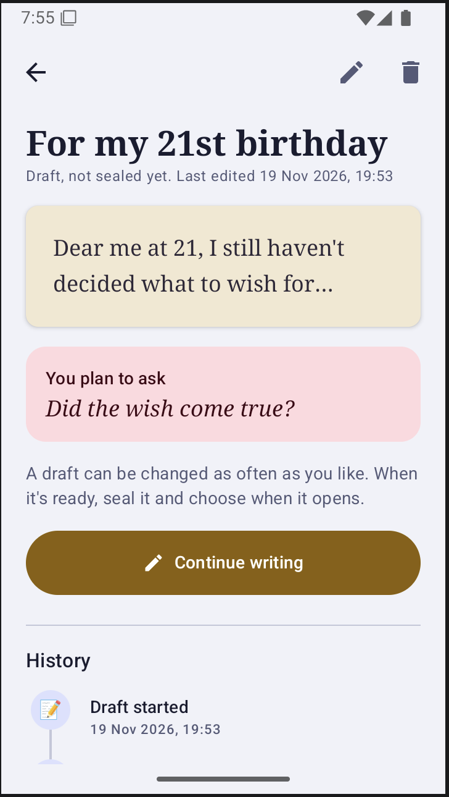
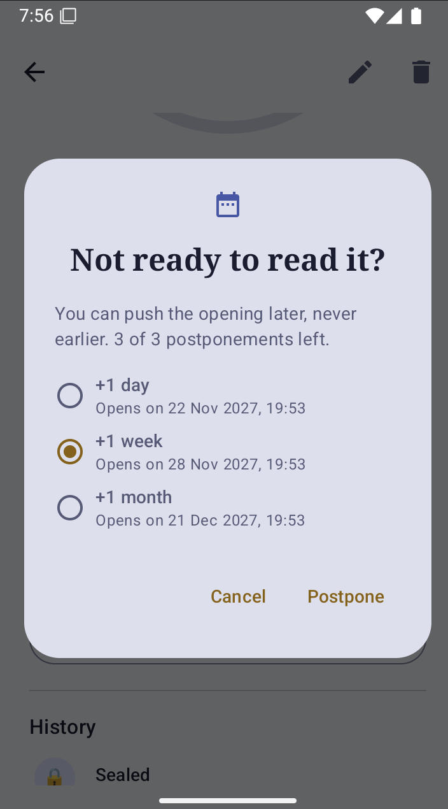
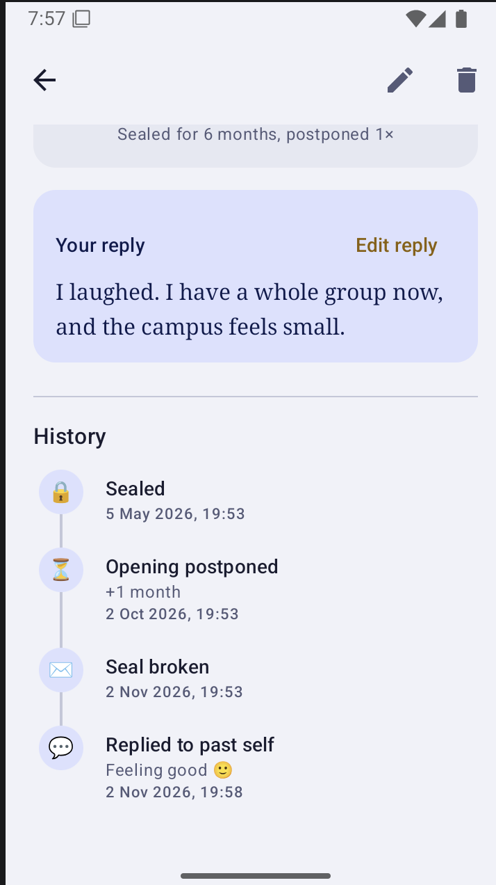
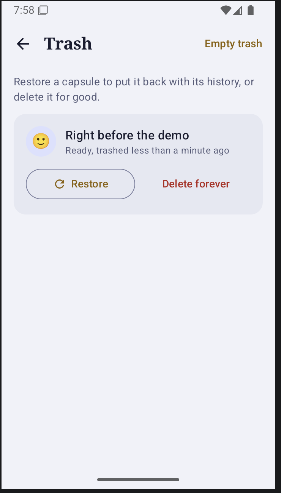
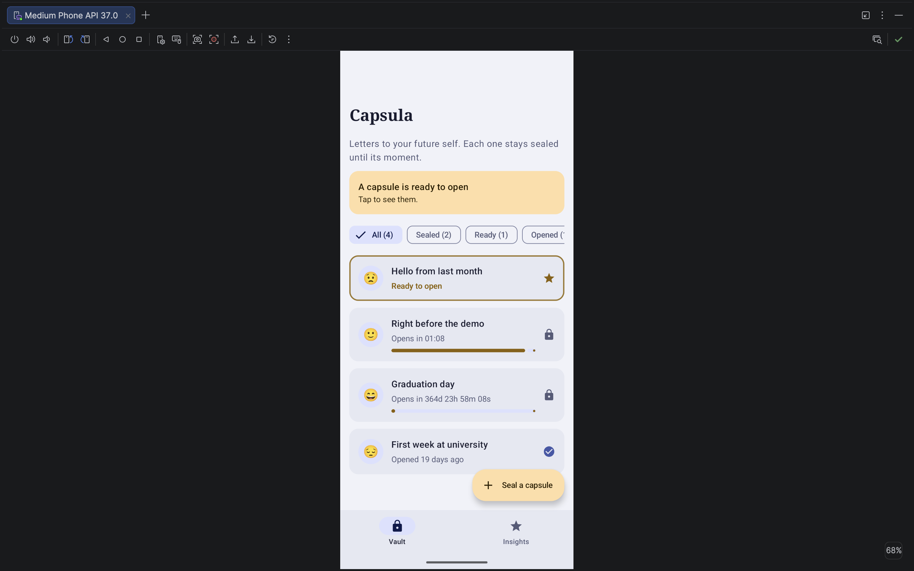
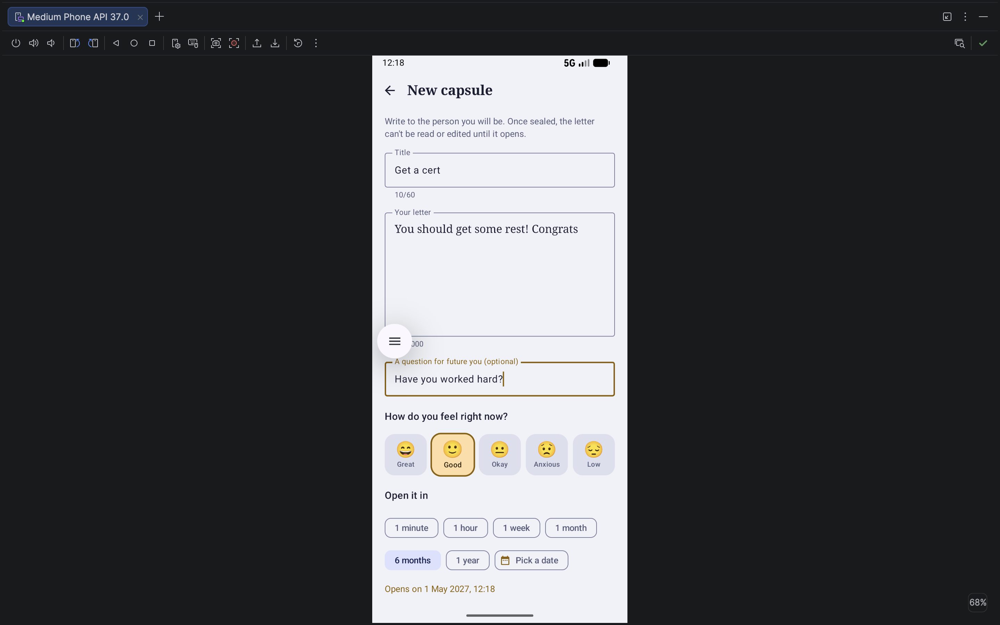
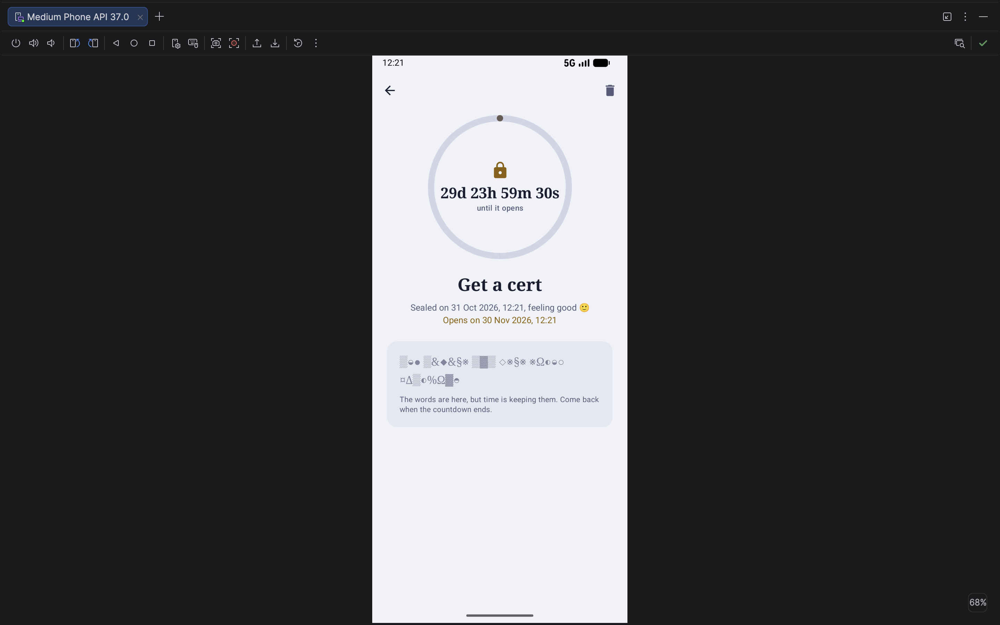
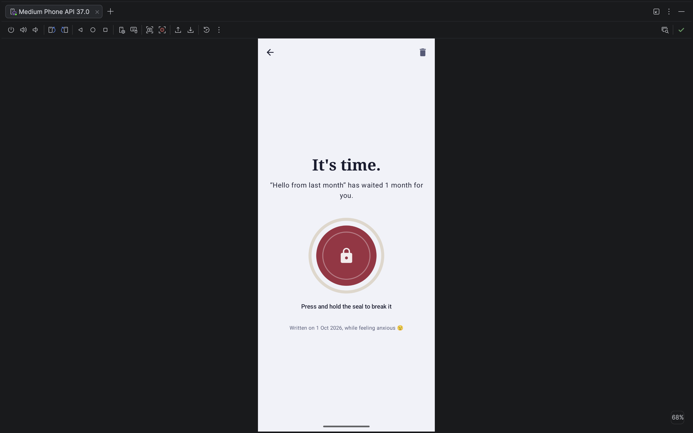
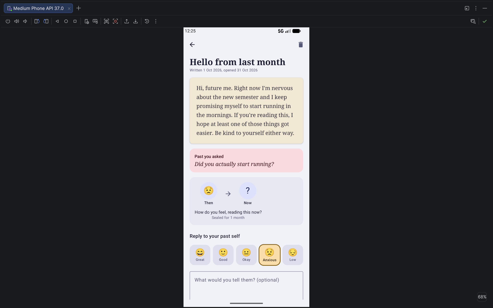
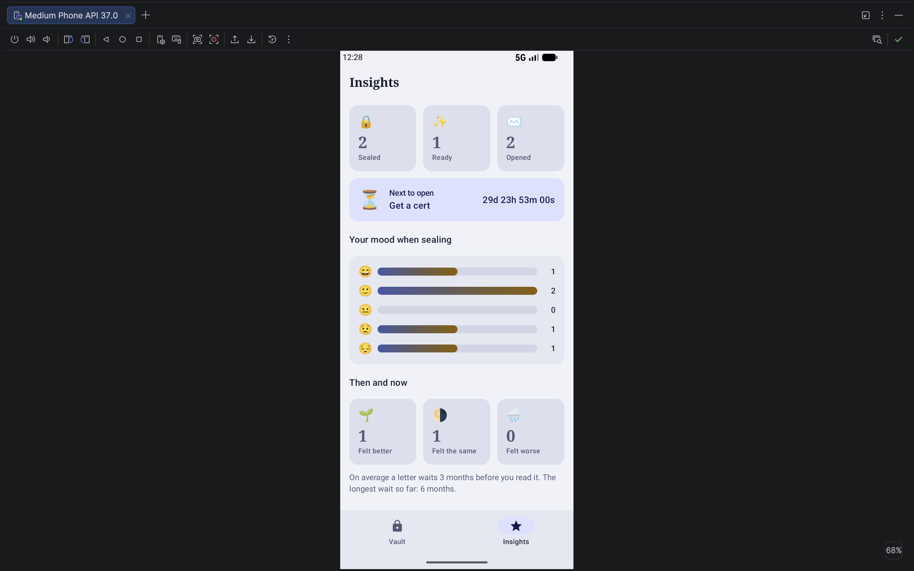

# Capsula — letters to your future self

Capsula is a time-capsule app. You write a letter to the person you will be, choose when it may be
opened, and seal it. Until that moment the letter can't be read or edited: the app only shows a live
countdown and the "seal" (the shape of your words, hidden behind shimmering glyphs). When the time
comes, you break a wax seal by pressing and holding it, the letter decodes itself on screen, and you
reply to your past self. Over time the app shows how your feelings changed between writing and reading.

**Why it is useful:** writing to your future self is a known reflection technique. It helps set
intentions ("did you start running?"), makes progress visible ("I was anxious, now I'm fine"), and
turns ordinary days into small events to look forward to.

Built with **Kotlin, Jetpack Compose, Material 3, Navigation Compose, MVVM (ViewModel + StateFlow),
Room, coroutines and Flow**.

**Version 2** adds a Room database (everything survives restarting the app), drafts and editing,
a capsule lifecycle with rules, a persistent history of every capsule, and a trash with restore.

## Additional feature: the capsule lifecycle with history

Every capsule moves through a multi-step workflow. Each step has its own rules, and every transition
is written to a separate Room table, so each capsule keeps a full, persistent history.

```
 DRAFT ──seal──▶ SEALED ──time passes──▶ READY ──break the seal──▶ OPENED ──reply──▶ (replied)
   ▲  │           │   ▲                    │
   └──┘ edit      │   └──── postpone ──────┘   (max 3 times, only later, never earlier)
                  └── rename (the letter stays sealed)

 Any stage ──move to trash──▶ TRASH ──restore──▶ back, with its history
                                 └──delete forever──▶ capsule and history erased
```

| Step | What the user does | Rule enforced |
|---|---|---|
| Draft | Writes, saves, comes back, edits | Only a title is required; drafts can be edited any number of times |
| Seal | Chooses an opening time and seals | Full validation: title, letter of at least 10 characters, mood, a future date. After sealing the letter can't be edited |
| Postpone | "Not ready to read it?" pushes the opening by a day, a week or a month | Only sealed or ready (not yet opened) capsules; at most 3 times; the new time is always later. A ready capsule that is postponed becomes sealed again |
| Rename | Changes the title of a sealed capsule | The letter itself stays sealed |
| Open | Holds the wax seal | Only when the countdown has ended |
| Reply | Picks today's mood and answers past self; can edit the reply later | Only after opening; a mood is required |
| Trash | Deletes with confirmation; **Undo** in the snackbar or **Restore** in the Trash screen | Soft delete: the capsule and its history stay in the database until "Delete forever" (also confirmed) |

The history is shown as a timeline on each capsule's screen, and the **Recent activity** feed on the
Insights screen joins events from all capsules. Insights also counts drafts in progress and how many
times capsules were postponed.

## Screenshots

### Additional feature

| Draft, edited and sealed later | Postponing the opening | History timeline | Trash with restore |
|---|---|---|---|
|  |  |  |  |

### Core screens

| Vault | New capsule | Sealed capsule |
|---|---|---|
|  |  |  |

| Wax seal | Opened letter | Insights |
|---|---|---|
|  |  |  |

## Features

1. **Write, save as a draft, seal.** Title, letter, an optional question for future you, your current
   mood, and the opening time: a preset (1 minute to 1 year) or any future date from the Material 3
   date picker. The same form is used to continue a draft. The form validates input, warns before
   discarding changes, and keeps what you typed even if Android kills the app in the background.
2. **Vault with live countdowns.** A `LazyColumn` with stable keys (the capsule id). Every capsule shows
   a ticking countdown and a progress bar. Filters (All / Drafts / Sealed / Ready / Opened) show counts.
   Capsules that are ready to open pulse gently and are listed first. A sealed capsule turns into a
   ready one at the exact second its countdown ends. The trash icon shows how many capsules are in the trash.
3. **The seal.** A sealed capsule's screen shows a countdown ring and the letter as glyphs that change
   every second: you see that your words are there, but not what they say.
4. **Opening ritual.** Press and hold the wax seal for 1.6 s (with haptic feedback; lifting the finger
   early rolls the ring back). The letter then decodes from glyphs into text, left to right.
   TalkBack users can open it with a regular accessibility action.
5. **Then and now.** After reading, you pick how you feel now and write a reply to your past self.
   The app compares the two moods ("You feel better than when you wrote this"). The reply can be edited.
6. **Lifecycle, history and trash** (see above).
7. **Insights.** Counts of drafts / sealed / ready / opened capsules and postponements, the next capsule
   to open with its countdown, a chart of moods at sealing time, how often you felt better, the same or
   worse when opening, the average and longest wait, and recent activity across all capsules.
8. **Feedback and empty states.** Every action confirms itself with a snackbar ("Reply saved",
   "Now opens on …", "… moved to trash · Undo"); every list has an empty state that says what to do next.

On the very first launch the database is filled with demo capsules once, so every stage can be shown
right away: a draft, a capsule that is ready, one that opens about 3 minutes after installation, one
that was postponed, opened and answered, and one sealed for a year. They are ordinary records: edit or
delete them and they won't come back. To try the full flow quickly, seal a capsule with the **1 minute** preset.

## Architecture (MVVM)

```
UI (Compose)                ViewModel (StateFlow)          Domain (pure Kotlin)        Data
--------------------        -----------------------        ---------------------       ------------------------------------
VaultScreen          --->   VaultViewModel          --->   CapsuleRules                CapsuleRepository (interface)
CreateCapsuleScreen  --->   CreateCapsuleViewModel  --->   CapsuleValidator              └ OfflineCapsuleRepository
CapsuleDetailScreen  --->   CapsuleDetailViewModel  --->   InsightsCalculator                └ CapsuleDao (Room)
InsightsScreen       --->   InsightsViewModel              TimeFormatter, SealCipher             └ CapsulaDatabase
TrashScreen          --->   TrashViewModel                 UnlockTime, tickerFlow                    ├ capsules
                                                                                                     └ capsule_events
```

* **Room.** Two entities: `CapsuleEntity` (table `capsules`) and `CapsuleEventEntity` (table
  `capsule_events`, one-to-many with a foreign key and `ON DELETE CASCADE`). One `CapsuleDao` with
  `Flow` queries for reading (including a `JOIN` for the activity feed) and `suspend` methods for writing.
  Methods marked `@Transaction` change a capsule and add a history event atomically. `TypeConverters`
  store enums as text.
* **Room Flow → UI.** The DAO returns `Flow`, the repository maps rows to domain models, ViewModels
  `combine` them with the ticker and expose `StateFlow<UiState>`, and screens collect it with
  `collectAsStateWithLifecycle()`. A change made on one screen (sealing, postponing, restoring from the
  trash) appears on every other screen without any refresh.
* **Repository.** `CapsuleRepository` is the only way ViewModels reach data. In version 1 it was backed
  by an in-memory list; in version 2 only one line in `AppContainer` changed to `OfflineCapsuleRepository`.
* **Domain rules.** `CapsuleRules` decides what is allowed at each stage; ViewModels check it before
  calling the repository, using fresh data from the database.
* **Unidirectional data flow and state hoisting.** Screens send events up (`onSaveDraftClick`,
  `postpone`, `restore`) and receive one immutable `UiState` down. Each screen is split into a stateful
  `XxxScreen` and a stateless `XxxContent`, which is also what the `@Preview`s render. Reusable components:
  `MoodSelector`, `CapsuleTimeline`, `WaxSealButton`, `CountdownRing`, `DecodingText`, `LetterCard`…
* **Sealed UI states.** The detail screen state is `Loading | NotFound | Draft | Sealed | Ready | Opened`,
  so the UI can't show a sealed letter's text or a postpone button on an opened capsule.
* **One-time events** (navigate after saving, close after trashing, snackbar messages) go through a
  `Channel` and are collected with `repeatOnLifecycle(STARTED)`.
* **Manual DI.** `AppContainer` (created in `CapsulaApplication`) owns the database, repository, clock
  and ticker. `AppViewModelProvider.Factory` builds every ViewModel with a `SavedStateHandle`.

### Navigation

`NavHost` with six destinations: `vault` and `insights` (bottom navigation, tab state saved and
restored), `trash`, `create`, `edit/{capsuleId}` (the same form, filled from the database) and
`capsule/{capsuleId}`. Route arguments are read by ViewModels from their `SavedStateHandle`.
After saving a new capsule the form is removed from the back stack (`popUpTo(create) { inclusive = true }`).
When a capsule is moved to the trash, the detail screen passes the result back through the previous
back-stack entry's `SavedStateHandle`, and the Vault (or Insights) shows the **Undo** snackbar.

### State, persistence and configuration changes

| What | Where it lives | Survives rotation | Survives restarting the app |
|---|---|---|---|
| Capsules, replies, history, trash | Room database (`capsula.db`) | yes | yes |
| Screen state | ViewModel `StateFlow`, derived from Room | yes | rebuilt from Room |
| Vault filter | `SavedStateHandle` | yes | while the app is in recents |
| Form input (new letter or draft being edited) | ViewModel + `SavedStateHandle` | yes | while the app is in recents |
| Open dialogs, reply being typed, decode progress | `rememberSaveable` | yes | while the app is in recents |
| Animation objects, coroutine scopes | `remember` | n/a | n/a |

### Project structure

```
app/src/main/java/com/capsula/app/
├── CapsulaApplication.kt, MainActivity.kt
├── di/AppContainer.kt
├── data/model/            Capsule, CapsuleEvent, Mood (domain models)
├── data/local/            CapsulaDatabase, CapsuleEntity, CapsuleEventEntity, CapsuleDao, Converters, Mappers, SampleCapsules
├── data/repository/       CapsuleRepository, OfflineCapsuleRepository
├── domain/                CapsuleRules, CapsuleValidator, InsightsCalculator, TimeFormatter, SealCipher, UnlockTime, TimeProvider
└── ui/
    ├── CapsulaApp.kt      NavHost
    ├── AppViewModelProvider.kt
    ├── navigation/        routes, bottom-bar destinations, trash result passed back
    ├── theme/             colors, typography, Material 3 theme
    ├── components/        CapsuleTimeline, WaxSealButton, CountdownRing, DecodingText, MoodSelector, TrashUndoEffect…
    ├── vault/  create/  detail/  insights/  trash/   screen + ViewModel + UiState for each feature
app/src/test/              unit tests: lifecycle rules, validation, statistics, and the repository with a fake DAO
```

## Running the project

Requirements: **Android Studio Ladybug (2024.2.1) or newer**, JDK 17 or 21 (bundled with Android Studio),
Android SDK 35. Minimum supported Android version: 8.0 (API 26).

1. Clone the repository: `git clone <repo-url>`
2. Open the folder in Android Studio (**File → Open**) and wait for Gradle sync to finish.
   If Android Studio asks to select a Gradle JDK, choose JDK 21 (the bundled JetBrains Runtime).
3. Choose an emulator or a device and press **Run ▶**.

From the command line: `./gradlew installDebug` (device connected) or `./gradlew assembleDebug`
(APK in `app/build/outputs/apk/debug/`). Unit tests: `./gradlew test`.

To check persistence: create or change a capsule, swipe the app away from recents (or press
**Stop** in Android Studio), and launch it again.

## Tech stack

Kotlin 2.0 · Jetpack Compose (BOM 2024.12) · Material 3 · Navigation Compose 2.8 ·
Lifecycle ViewModel / runtime-compose 2.8 · Room 2.6 (KSP) · Kotlin coroutines and Flow · JUnit 4.
